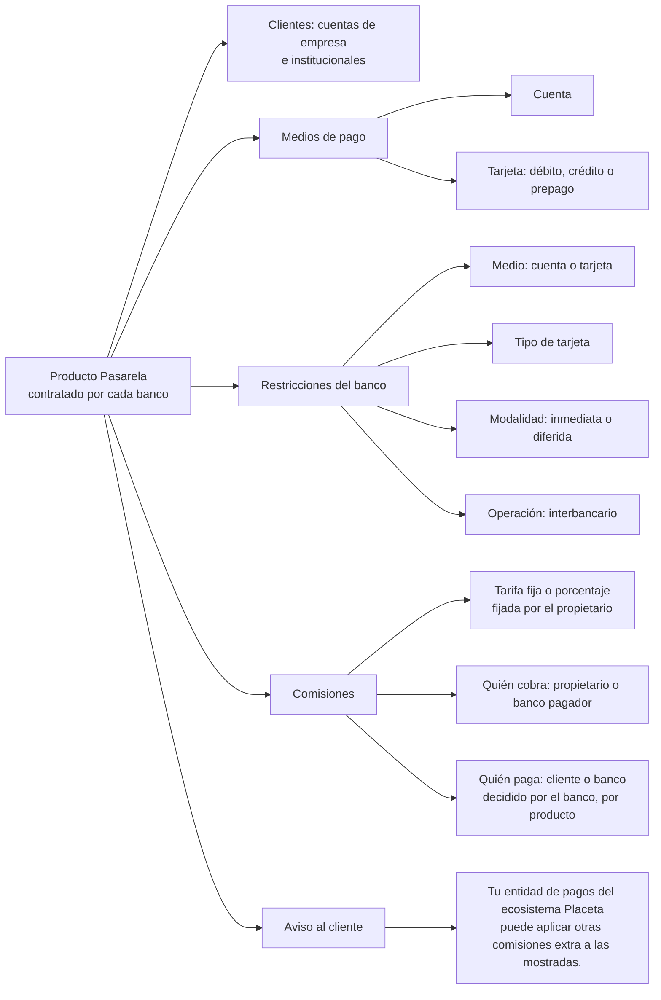
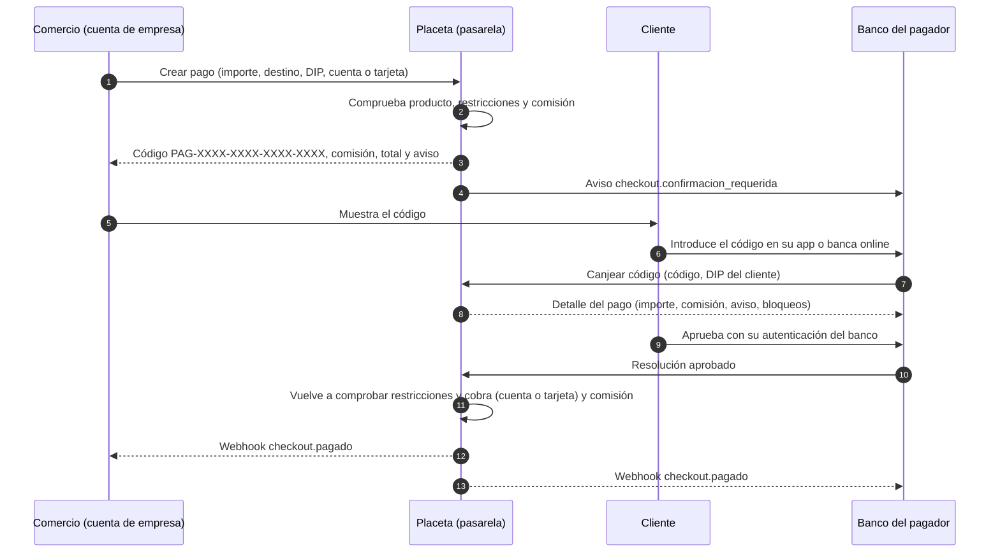
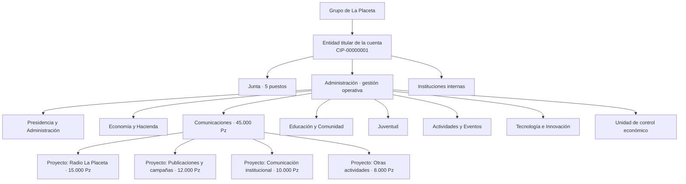
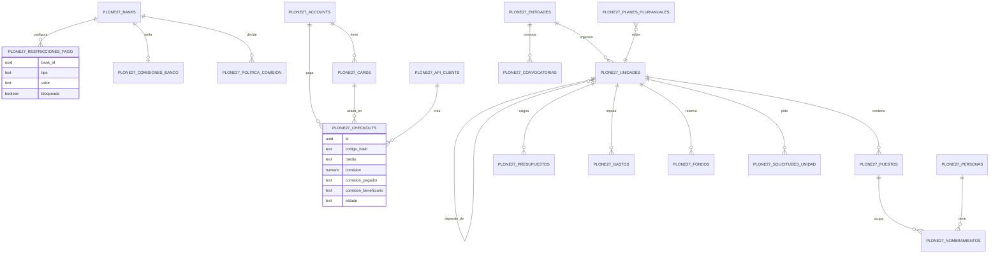

# Arquitectura de la pasarela de pago (Placeta One)

Los diagramas están en formato Mermaid. Se ven en GitHub, en VS Code (extensión Markdown Preview Mermaid) y en la mayoría de wikis.

## 1. Producto: la pasarela es un producto por banco

## 2. Flujo de un pago con código

Placeta no abre ninguna sesión propia del cliente ni pide credenciales. La sesión la tiene el banco.

## 3. Organigrama institucional (ejemplo: Grupo de La Placeta)

El presupuesto de un proyecto se descuenta de su departamento y de la entidad sin duplicarse.

## 4. Modelo de datos (esquema)

## 5. Qué configura cada parte

| Quién | Qué configura | Dónde |
|---|---|---|
| Propietario de la pasarela | Tarifa por banco (fija o en porcentaje) y quién cobra la comisión | Panel: API de comisiones del propietario |
| Banco | Quién paga la comisión en cuentas y en tarjetas | API `PUT /api/v1/bk/comisiones` |
| Banco | Restricciones: medios, tipos de tarjeta, modalidades y operaciones | API `PUT /api/v1/bk/restricciones` |
| Banco | Canje de códigos y resolución de pagos | API `/api/v1/bk/pagos/...` |
| Comercio | Crear pagos y mostrar el código | API `POST /api/v1/bk/checkouts` |

## 6. Pendiente de decidir

- Si la ventana de pago web se mantiene como alternativa al código o se retira.
- Si las restricciones también se aplican al lado del comercio (por ejemplo, prohibir cobrar con tarjeta de crédito).
- El precio y las condiciones del producto por banco.
