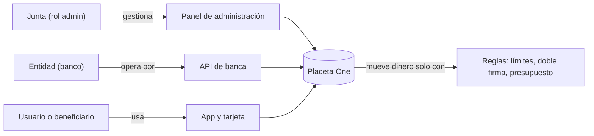
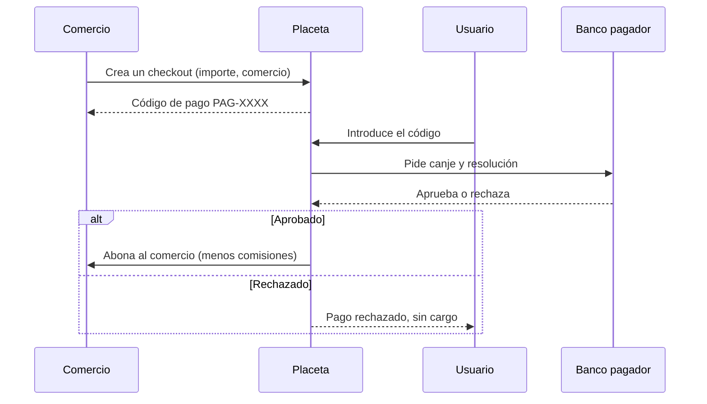
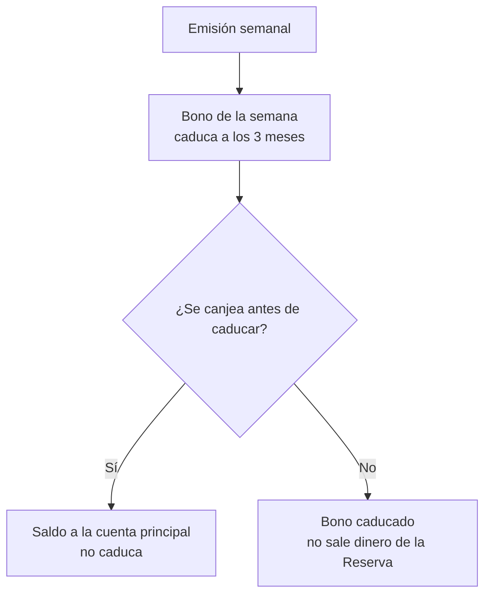
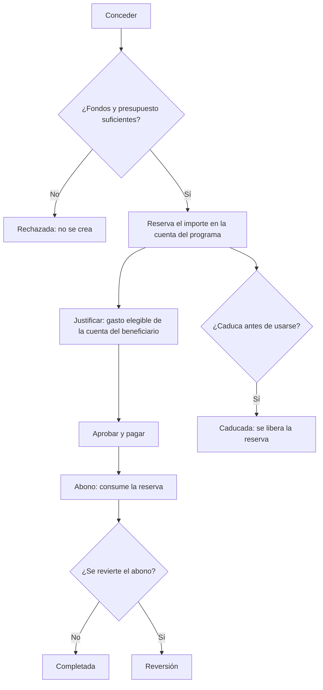
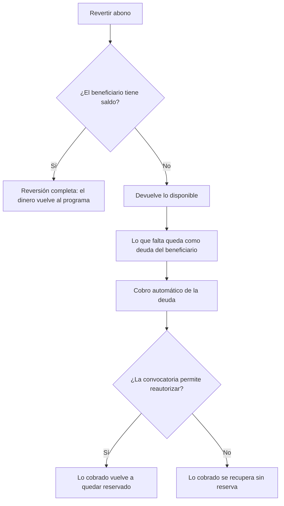
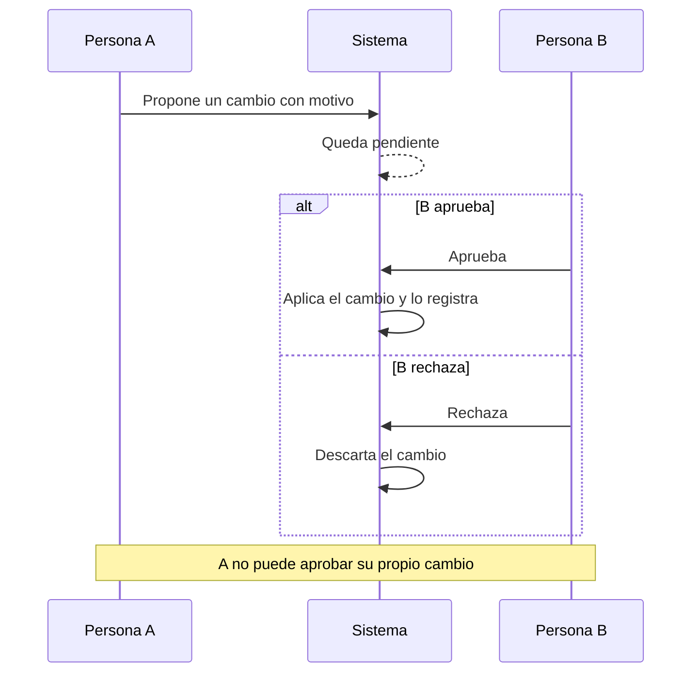
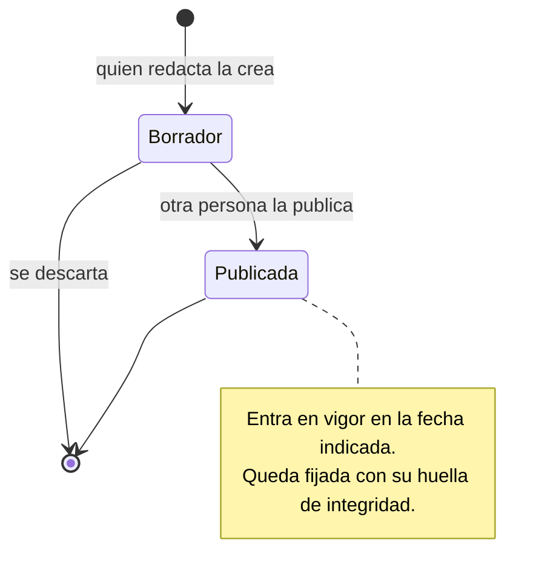
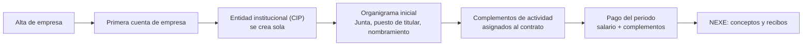
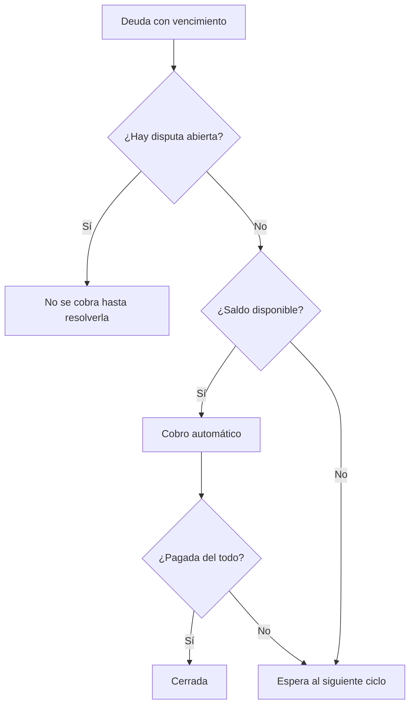
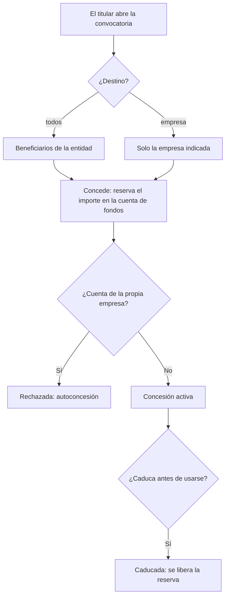

# Flujos de Placeta One

Cada flujo tiene un diagrama y una explicación. Los diagramas se ven en GitHub y en cualquier visor de Markdown con soporte de Mermaid.

## 1. Quién hace qué



**Qué significa.** La Junta gestiona el sistema desde el panel. Cada entidad (banco) opera sus propios clientes, empresas y programas por la API de banca, y no ve los de otra entidad. Los usuarios usan la app y la tarjeta. Todo movimiento de dinero pasa por las reglas del sistema.

## 2. Pago con pasarela (checkout)



**Qué significa.** El comercio crea un cobro y recibe un código. El usuario lo introduce y el banco del pagador decide si aprueba. Solo si aprueba se abona al comercio, descontando las comisiones configuradas. Un rechazo no mueve dinero.

## 3. RBU semanal: emisión, canje y caducidad



**Qué significa.** Cada semana se emite un bono por usuario. Tiene tres meses para canjearse. Si se canjea, el saldo pasa a la cuenta principal y ya no caduca, se gaste o no. Si no se canjea, caduca y no sale ni un céntimo de la Reserva.

## 4. Subvención: del alta al abono



**Qué significa.** Conceder reserva el dinero antes de nada, así que el presupuesto siempre está protegido. Justificar y abonar consumen esa reserva. Si la subvención caduca antes de usarse, la reserva se libera. Una reversión se trata en el flujo 5.

## 5. Reversión de un abono



**Qué significa.** Revertir nunca deja saldo negativo. Si el beneficiario tiene saldo, la reversión es completa. Si no, lo disponible vuelve de inmediato y el resto se convierte en deuda, que el sistema cobra cuando el beneficiario tenga fondos. Lo cobrado solo se reautoriza si la convocatoria está abierta y lo permite.

## 6. Cambio de ajustes con doble firma



**Qué significa.** Un cambio de ajuste lo propone una persona y lo aprueba otra. Nadie se aprueba a sí mismo, ni siquiera el admin. Cada paso queda en la auditoría con su motivo.

## 7. Publicar una versión fiscal



**Qué significa.** Una versión fiscal nace como borrador de quien la redacta. Para entrar en vigor la publica otra persona. Una vez publicada queda fijada con una huella que permite comprobar que no se ha cambiado.

## 8. Empresa, entidad, organigrama y nómina



**Qué significa.** Al dar de alta una empresa y añadirle una cuenta, su entidad institucional se crea sola, con un organigrama inicial para que el titular pueda empezar. Sobre cada contrato se asignan complementos de actividad. El pago del periodo incluye salario y complementos, y NEXE lee los conceptos y los recibos.

## 9. Deuda: cobro automático



**Qué significa.** Una deuda se cobra sola cuando vence, si no hay disputa abierta y hay saldo. Si no hay saldo, espera al siguiente ciclo diario. Una disputa la detiene hasta que se resuelva.

## 10. Convocatoria de una empresa



**Qué significa.** La empresa abre la convocatoria y elige el destino. Cada concesión reserva su importe en la cuenta de fondos de la propia empresa. Nunca se puede conceder a una cuenta de la empresa misma. Lo no usado caduca y se libera.

## Cómo validar estos diagramas

Cada bloque `mermaid` se extrae a un archivo `.mmd` y se renderiza con el CLI de Mermaid:

```bash
mmdc -i flujo.mmd -o flujo.svg   # debe terminar sin errores y generar el SVG
```

Un diagrama que no se renderiza no se publica.
